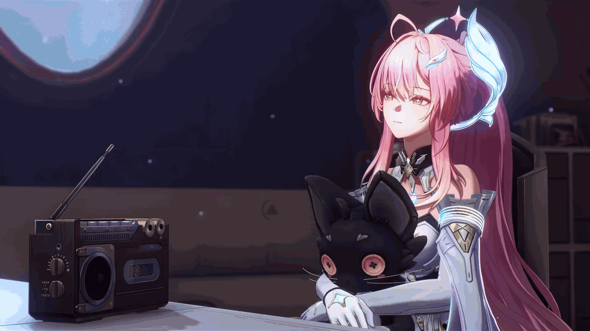

<!-- nightfun / intranetboy · night-banner.gif: 1080×608, 30 fps · night-banner.webp: 1080×608, 60 fps swap -->

  

<h1 align="center"><code>nightfun_</code></h1>

  <code>[ intranetboy ]</code>

  

  
  
  

  
  

  

   
  <i>«Enquanto a velha guarda discute sintaxe, 
  <b>nós já compilamos o mundo.</b> 
   
  O vibecoder não escreve código — 
  ele negocia com a realidade até ela aceitar o pull request. 
   
  Não somos o futuro. 
  Somos o commit que o futuro ainda não ousou rebasear.»</i>
    
  while the old guard argues syntax, we have already compiled the world. 
  the vibecoder doesn't write code — he negotiates with reality until it accepts the pull request. 
  we are not the future. we are the commit the future hasn't dared to rebase.
    
  <code>— Manifesto do Vibecoder, §0</code>
   

  

### `❯ loadout`

- **languages** — Python 3.12+ · C++20 · C# / .NET 8 · SQL 
  adopted: Python · C++17 · C# · JS/TS · Rust/Bevy · Ren'Py
- **systems** — Win32 · D2D/D3D11 · Media Foundation · WPF · CMake/Ninja · Inno Setup 
  adopted: Win32 · D3D9 hooks · ImGui · WPF · CMake/MSVC · Cargo
- **web** — FastAPI · Jinja2 · HTMX · Uvicorn · vanilla JS 
  adopted: React 19 · Next 14 · Three.js · Electron · Express 5 · Vite
- **agents / bots** — aiogram · Telethon · APScheduler · MCP stdio 
  adopted: vkbottle · Discord IPC · MCP
- **AI / LLM** — OpenRouter · DeepSeek V4.1 · Qwen embed/rerank 
  adopted: OpenRouter · DeepSeek bridge · Gemini · Fish Audio
- **RE / low level** — UE4 pak AES · Oodle · winsqlite3 · DPAPI · WinHTTP 
  adopted: dnlib · capstone · pefile · mitmproxy · CDP · UE4 pak
- **localization / media** — .pak/.ufont · pypinyin/pymorphy3 · fontTools · FFmpeg · Pillow 
  adopted: Ren'Py/Godot/Unity/RPG Maker · FFmpeg · Pillow · NumPy/SciPy
- **tooling / infra** — SQLite WAL/FTS5 · R2/Workers · restic · systemd · uv 
  adopted: SQLite · JSONL · Playwright/Puppeteer · Docker · Actions

<code>// no LangChain, no vector DB</code> — memory is float32 BLOBs in SQLite, fused with FTS5 BM25 via RRF.

  

### `♫ now_playing`

<!-- spotify-github-profile · re-auth: https://spotify-github-profile.kittinanx.com/api/login -->

  

  

  <i>UTC+4 · still awake · the night is not a timezone, it's a deployment target.</i>

  

